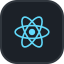
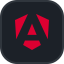
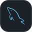

  

###

 **FullStack Software Developer & AI-Driven Engineering**
<!---->

 
 

###

### Main Stack

    

###

<h2 align="center">Skills</h2>

<h3>Languages</h3>

  
  
  
  
  
  

<h3>Frontend</h3>

  
  
  
  
  

<h3>Backend</h3>

  
  
  
  
  
  

<h3>Development Tools</h3>

  
  
  
  

